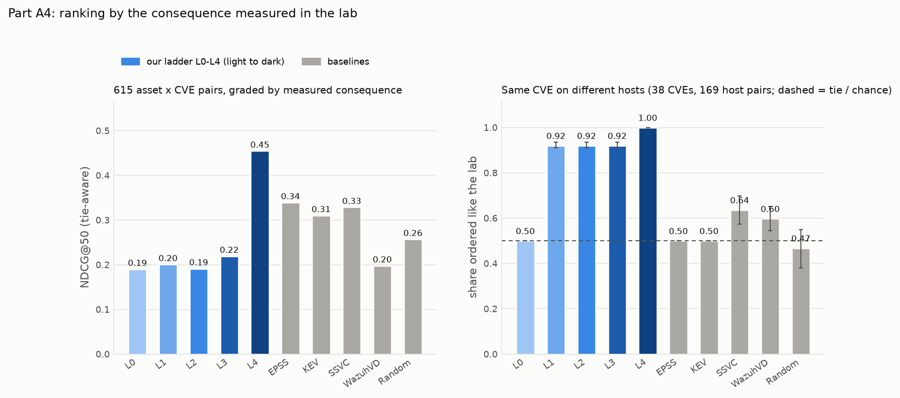
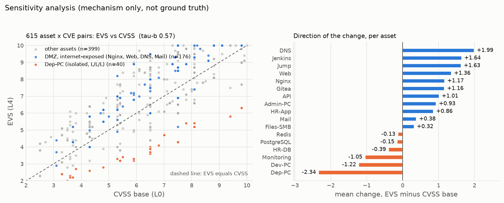

# Final check: full rebuild, validation and results (2026-11-17)

## Graph build

## Part B: blast radius against the lab's measured ground truth

Measured: network 2026-11-16T15:49:15+00:00; usable 2026-11-16T15:49:22+00:00; dependents 2026-11-16T15:58:45+00:00.

Per (asset, CVE) pair, pooled over (host, affected host) pairs:

| Variant | Precision | Recall | F1 |
|---|---:|---:|---:|
| B0 | - | 0.000 | - |
| B1 (k=1) | 0.525 | 0.996 | 0.687 |
| B1 (k=2) | 0.049 | 1.000 | 0.094 |
| B2 | 0.114 | 0.996 | 0.204 |
| B3 | 0.525 | 0.996 | 0.687 |
| B4 | 0.968 | 0.996 | 0.982 |
| B5 (k=2) | 0.600 | 1.000 | 0.750 |
| B5 (k=3) | 0.534 | 1.000 | 0.696 |

Hosts the pentest reached from its foothold (independent of the edges): pooled recall per variant, and hosts predicted per foothold:

| Variant | Recall | Predicted per foothold |
|---|---:|---:|
| B0 | 0.000 | 0.0 |
| B1 (k=1) | 0.273 | 1.0 |
| B1 (k=2) | 1.000 | 16.0 |
| B2 | 1.000 | 7.6 |
| B3 | 0.273 | 1.0 |
| B4 | 0.182 | 0.5 |
| B5 (k=2) | 0.182 | 0.8 |
| B5 (k=3) | 0.182 | 0.8 |

EVS with each variant's set inside P(a,c), ranked against the A4 consequence labels:

| Variant | NDCG@50 | AP | Kendall tau-b | Same-CVE concordance |
|---|---:|---:|---:|---:|
| B0 | 0.219 | 0.719 | 0.078 | 0.920 |
| B1 (k=1) | 0.302 | 0.789 | 0.181 | 1.000 |
| B1 (k=2) | 0.235 | 0.731 | 0.093 | 1.000 |
| B2 | 0.272 | 0.750 | 0.110 | 1.000 |
| B3 | 0.302 | 0.789 | 0.181 | 1.000 |
| B4 | 0.454 | 0.882 | 0.317 | 1.000 |
| B5 (k=2) | 0.474 | 0.889 | 0.343 | 1.000 |
| B5 (k=3) | 0.482 | 0.890 | 0.344 | 1.000 |

## Part A4: ranking by the consequence measured in the lab

615 asset x CVE pairs, 388 with a measured consequence (prevalence 0.63). Full tables: `eval_consequence.md`.

| Score | NDCG@50 | AP | Kendall tau-b | Same-CVE concordance |
|---|---:|---:|---:|---:|
| L0 | 0.190 | 0.637 | -0.043 | 0.500 |
| L1 | 0.201 | 0.711 | 0.067 | 0.920 |
| L2 | 0.191 | 0.714 | 0.076 | 0.920 |
| L3 | 0.219 | 0.719 | 0.078 | 0.920 |
| L4 | 0.454 | 0.882 | 0.317 | 1.000 |
| EPSS | 0.339 | 0.686 | 0.026 | 0.500 |
| KEV | 0.310 | 0.646 | 0.052 | 0.500 |
| SSVC | 0.329 | 0.780 | 0.156 | 0.636 |
| WazuhVD | 0.198 | 0.653 | 0.005 | 0.598 |
| Random | 0.257 | 0.624 | -0.024 | 0.467 |

| Comparison | change in NDCG@50 [95% CI] |
|---|---|
| L1 − L0 | +0.011 [-0.024, +0.042] |
| L2 − L1 | -0.009 [-0.032, +0.003] |
| L3 − L2 | +0.028 [+0.004, +0.075] * |
| L4 − L3 | +0.235 [+0.143, +0.293] * |
| L4 − L0 | +0.264 [+0.165, +0.328] * |
| L4 − EPSS | +0.115 [+0.027, +0.194] * |
| L4 − KEV | +0.144 [+0.039, +0.200] * |
| L4 − SSVC | +0.126 [+0.017, +0.185] * |
| L4 − WazuhVD | +0.257 [+0.158, +0.322] * |
| L4 − Random | +0.198 [+0.059, +0.283] * |

## Part A: score ladder against pentest ground truth

### A1. Vulnerabilities on assets (asset × CVE, no alert)

9 labelled pairs from `pentest_results.csv` (1 exploited); `not_tried` pairs are left out. Relevance = exploited (1/0). Bootstrap resamples pairs. Origin: 0 drawn by the sampler (`pentest_candidates.csv`), 9 hand-picked. WazuhVD: 2 pairs reported by Wazuh, 7 not (CVSS base used).

| Score | NDCG@5 | NDCG@10 | P@5 | P@10 | MRR | AP |
|---|---:|---:|---:|---:|---:|---:|
| L0 | 0.710 | 0.710 | 0.200 | 0.100 | 0.606 | 0.606 |
| L1 | 0.710 | 0.710 | 0.200 | 0.100 | 0.603 | 0.603 |
| L2 | 0.710 | 0.710 | 0.200 | 0.100 | 0.596 | 0.596 |
| L3 | 1.000 | 1.000 | 0.200 | 0.100 | 1.000 | 1.000 |
| L4 | 1.000 | 1.000 | 0.200 | 0.100 | 1.000 | 1.000 |
| EPSS | 1.000 | 1.000 | 0.200 | 0.100 | 1.000 | 1.000 |
| KEV | 1.000 | 1.000 | 0.200 | 0.100 | 1.000 | 1.000 |
| SSVC | 1.000 | 1.000 | 0.200 | 0.100 | 1.000 | 1.000 |
| WazuhVD | 0.710 | 0.710 | 0.200 | 0.100 | 0.606 | 0.606 |
| Random | 0.431 | 0.431 | 0.200 | 0.100 | 0.250 | 0.250 |

| Comparison | change in NDCG@10 [95% CI] (* = CI excludes 0) |
|---|---|
| L1 − L0 | +0.000 [+0.000, +0.000] |
| L2 − L1 | +0.000 [+0.000, +0.000] |
| L3 − L2 | +0.290 [+0.000, +0.410] |
| L4 − L3 | +0.000 [+0.000, +0.000] |
| L4 − EPSS | +0.000 [+0.000, +0.000] |
| L4 − KEV | +0.000 [+0.000, +0.000] |
| L4 − SSVC | +0.000 [+0.000, +0.000] |
| L4 − WazuhVD | +0.290 [+0.000, +0.410] |
| L4 − Random | +0.569 [+0.000, +0.667] |

### A2

No labelled data in this run.

## Sensitivity: how the EVS reprioritises CVSS (mechanism only, not ground truth)

Kendall tau-b 0.566; 33474 of 188805 pairs reorder; 27619 cross-asset reorderings with a CVSS gap of at least 0.5.

| Asset | CR/IR/AR | Internet-reachable | Mean change | Median change | CVEs |
|---|:--:|:--:|--:|--:|--:|
| Dep-PC | L/L/L | no | -2.34 | -2.55 | 40 |
| Dev-PC | M/M/L | no | -1.22 | -1.25 | 40 |
| Monitoring | M/M/L | no | -1.05 | -0.10 | 19 |
| HR-DB | H/H/M | yes | -0.39 | -0.60 | 22 |
| PostgreSQL | H/H/M | yes | -0.15 | -0.65 | 46 |
| Redis | M/M/M | yes | -0.13 | -0.55 | 18 |
| Files-SMB | H/M/M | yes | +0.32 | +0.90 | 5 |
| Mail | H/M/M | yes | +0.38 | -0.30 | 38 |
| HR-App | H/H/L | yes | +0.86 | +0.90 | 59 |
| Admin-PC | H/H/L | no | +0.93 | +1.05 | 40 |
| API | H/H/M | yes | +1.01 | +1.10 | 7 |
| Gitea | H/H/M | yes | +1.16 | +1.00 | 45 |
| Nginx | M/M/H | yes | +1.17 | +1.20 | 22 |
| Web | M/M/H | yes | +1.36 | +1.20 | 69 |
| Jump | H/H/M | no | +1.63 | +1.70 | 40 |
| Jenkins | M/H/M | yes | +1.64 | +1.55 | 58 |
| DNS | L/H/H | yes | +1.99 | +2.50 | 47 |

## Parameter sensitivity (beta, gamma)

Across the 15 settings, Kendall tau-b against the default ranges 0.781 to 1.000. This is the stability of the score's own ranking; it is not tuning against ground truth.

