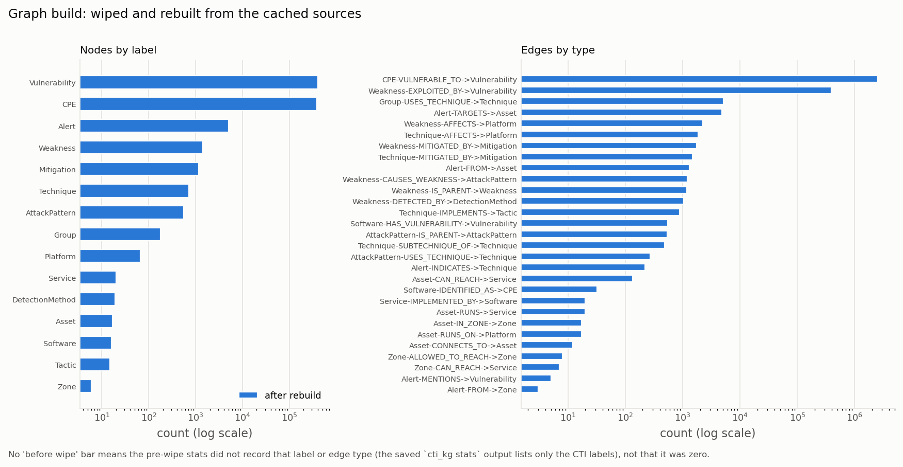
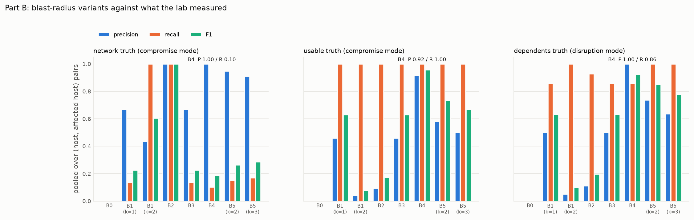
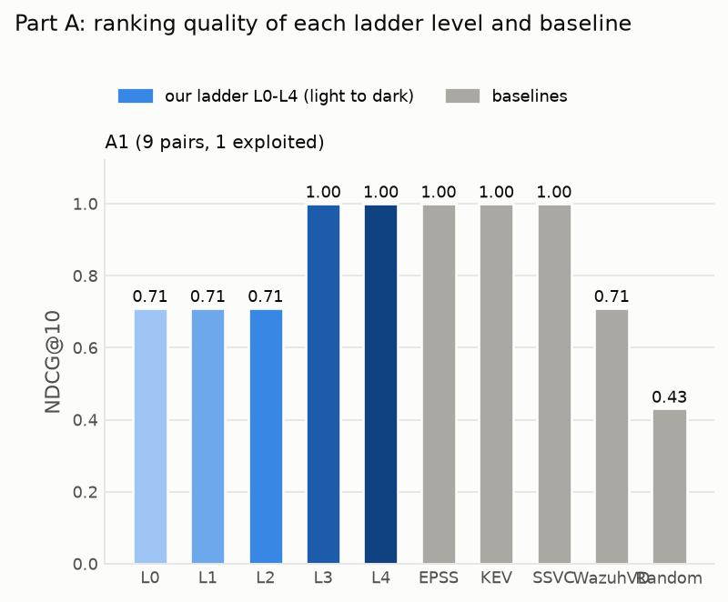
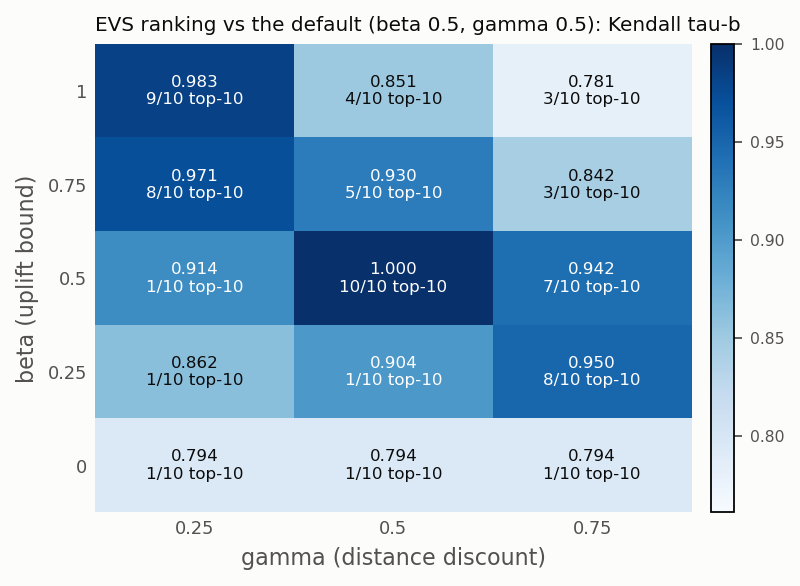

# Final check: full rebuild, validation and results (2026-11-15)

> **8-host lab.** Generated on the original 8-host lab, before it grew to 17 hosts and a MGMT zone on 2026-11-16 (`lab_env/README.md`). The numbers below are unchanged; rerun the generating command to update them.

## Summary

The whole system was rebuilt from scratch on 2026-11-15: Neo4j wiped to 0 nodes / 0 relationships, the CTI graph reloaded
from the cached sources, the asset graph reloaded and relinked, alerts re-fetched (last 7 days) and re-contextualised,
the EVS recomputed, lab ground truth re-measured, and the stage-5 reports regenerated. Backups of the previous run
(alerts, ground truth, reports, pre-wipe counts) are in `data/backup-2026-11-15/`.

| Check | Result |
|---|---|
| Wipe | 0 nodes, 0 relationships |
| CTI rebuild | exit 0; Vulnerability 406,379 → 406,586 (+207, upstream feeds updated), CPE 378,622 → 378,651 |
| CTI validation | CAPEC→ATT&CK recall 99.63 %, CAUSES_WEAKNESS F1 100 %, EXPLOITED_BY (most-specific CWEs) F1 94.91 % (94.90 % before) |
| Asset graph | 8 assets, 5 zones, 9 services, 7 software; 257 HAS_VULNERABILITY (unchanged); all 7 integrity checks ok; CPE linking 7/7 |
| Unit tests | 75 passed |
| Lab ground truth | re-measured (network, usable, dependents); **identical to the previous measurement** on all three, and every host came back up |
| Alerts | 5,664 raw (7 days) → 183 with graph context (24 raw before) |
| Scored pairs | 287 asset × CVE (288 before): Admin-PC and Dep-PC 41 → 40 (OpenSSH, 40 of 41 OSV CVEs now in the graph), Web 68 → 69. Consistent with refreshed upstream feeds; the individual CVEs were not traced |

## What the results do and do not show

- **Part B is the strongest result and it reproduces.** Against the measured usable-reach truth, B4 (ours, Algorithm 1) has
  precision 1.000, recall 1.000, F1 1.000; B2 (zone-level) 0.312; B1 k=1 0.646; B5 k=2 0.875. Against dependents (disruption),
  B4 F1 is 0.958. **Not in B4's favour:** against raw TCP network reachability, B2 (zone-level) wins (F1 1.000 vs B4 0.312,
  B4 recall 0.208), because B4 follows only the paths the policy and graph model as usable, not every open port.
- **A1 cannot discriminate.** 6 labelled pairs, 1 exploited (Jenkins CVE-2024-23897). Every score, ladder and baseline, ranks it first
  (NDCG@10 1.000 everywhere).
- **A2 is dominated by one artifact and should not be read as five scenarios.** The single alert instance
  `Web | CVE-2024-38476 | rule 31164` is counted in S04, S05, S06 and S07 because those scenarios ran within ~10 s of each other and
  the ±120 s match slack makes their windows overlap (it is graded 0, 0, 0, 1). That is one observation counted four times. It
  depresses MRR (0.200) and P@5 (0.040) identically for every score, so it does not separate any of them. The matching was
  deliberately **not changed** during this run.
- **EVS vs CVSS in A2: no difference.** L0 to L4 are identical because every alerting CVE is CVSS 9.8 (EVS ceiling 10), so ranking within
  a scenario is decided by the id tiebreak, not by the score.
- **EVS vs Wazuh rule.level:** +0.145 NDCG@10, 95 % CI [0.000, 0.290], so the interval touches 0 and this is not significant on its
  own. It is half the earlier S08-only figure (+0.290) because the duplicated S07 instance adds a scenario where every score
  ties. The earlier, cleaner statement still holds in S08: Wazuh ranks the harmless SQLi probe (level 6) above the real Jenkins
  file read (level 3), and every vulnerability-aware score avoids that inversion.
- **Sensitivity is mechanism analysis, not validation.** Over all 287 pairs the EVS keeps the broad CVSS order but reorders within
  it (Kendall tau-b 0.694). There is no outcome label behind it.
- **β / γ:** across the 15 settings the EVS ranking stays within Kendall tau-b ≥ 0.906 of the default. This is stability of the score's
  own ranking, not tuning against ground truth, which the ceiling-saturated labels cannot support.

## Follow-ups this run points to (not done here)

1. Attribute each alert instance to one scenario (for example by requiring the asset and time to match a step, or by
   non-overlapping windows) so S04-S07 stop sharing a single alert.
2. Add exploited CVEs below the 9.8 ceiling on high-value hosts; that is what A1/A2 need before the EVS can be separated from CVSS.

## Graph build

## Part B: blast radius against the lab's measured ground truth

Measured: network 2026-11-15T00:46:14+00:00; usable 2026-11-15T00:46:17+00:00; dependents 2026-11-15T00:50:31+00:00.

Per (asset, CVE) pair:

| Variant | Precision | Recall | F1 |
|---|---:|---:|---:|
| B0 | 1.000 | 0.328 | 0.328 |
| B1 (k=1) | 0.677 | 0.997 | 0.718 |
| B1 (k=2) | 0.098 | 1.000 | 0.170 |
| B2 | 0.260 | 0.997 | 0.362 |
| B3 | 0.677 | 0.997 | 0.718 |
| B4 | 1.000 | 0.997 | 0.998 |
| B5 (k=2) | 0.775 | 1.000 | 0.850 |
| B5 (k=3) | 0.764 | 1.000 | 0.840 |

L4 ranking (NDCG@10, A1 labels) with each variant's P(u):

| Variant | NDCG@10 |
|---|---:|
| B0 | 1.000 |
| B1 (k=1) | 1.000 |
| B1 (k=2) | 1.000 |
| B2 | 1.000 |
| B3 | 1.000 |
| B4 | 1.000 |
| B5 (k=2) | 1.000 |
| B5 (k=3) | 1.000 |

## Part A: score ladder against pentest ground truth

### A1. Vulnerabilities on assets (asset × CVE, no alert)

6 labelled pairs from `pentest_results.csv` (1 exploited); `not_tried` pairs are left out. Relevance = exploited (1/0). Bootstrap resamples pairs.

| Score | NDCG@5 | NDCG@10 | P@5 | P@10 | MRR |
|---|---:|---:|---:|---:|---:|
| L0 | 1.000 | 1.000 | 0.200 | 0.100 | 1.000 |
| L1 | 1.000 | 1.000 | 0.200 | 0.100 | 1.000 |
| L2 | 1.000 | 1.000 | 0.200 | 0.100 | 1.000 |
| L3 | 1.000 | 1.000 | 0.200 | 0.100 | 1.000 |
| L4 | 1.000 | 1.000 | 0.200 | 0.100 | 1.000 |
| EPSS | 1.000 | 1.000 | 0.200 | 0.100 | 1.000 |
| KEV | 1.000 | 1.000 | 0.200 | 0.100 | 1.000 |
| SSVC | 1.000 | 1.000 | 0.200 | 0.100 | 1.000 |

| Comparison | change in NDCG@10 [95% CI] (* = CI excludes 0) |
|---|---|
| L1 − L0 | +0.000 [+0.000, +0.000] |
| L2 − L1 | +0.000 [+0.000, +0.000] |
| L3 − L2 | +0.000 [+0.000, +0.000] |
| L4 − L3 | +0.000 [+0.000, +0.000] |
| L4 − EPSS | +0.000 [+0.000, +0.000] |
| L4 − KEV | +0.000 [+0.000, +0.000] |
| L4 − SSVC | +0.000 [+0.000, +0.000] |

### A2. Alerted vulnerability instances, per pentest scenario

5 scenarios, 6 instances in their time windows. Grades 3/2/1/0 from the pentest record. Metrics averaged over scenarios; bootstrap over scenarios.

| Score | NDCG@5 | NDCG@10 | P@5 | P@10 | MRR |
|---|---:|---:|---:|---:|---:|
| L0 | 1.000 | 1.000 | 0.040 | 0.020 | 0.200 |
| L1 | 1.000 | 1.000 | 0.040 | 0.020 | 0.200 |
| L2 | 1.000 | 1.000 | 0.040 | 0.020 | 0.200 |
| L3 | 1.000 | 1.000 | 0.040 | 0.020 | 0.200 |
| L4 | 1.000 | 1.000 | 0.040 | 0.020 | 0.200 |
| EPSS | 1.000 | 1.000 | 0.040 | 0.020 | 0.200 |
| KEV | 1.000 | 1.000 | 0.040 | 0.020 | 0.200 |
| SSVC | 1.000 | 1.000 | 0.040 | 0.020 | 0.200 |
| Wazuh | 0.855 | 0.855 | 0.040 | 0.020 | 0.100 |

| Comparison | change in NDCG@10 [95% CI] (* = CI excludes 0) |
|---|---|
| L1 − L0 | +0.000 [+0.000, +0.000] |
| L2 − L1 | +0.000 [+0.000, +0.000] |
| L3 − L2 | +0.000 [+0.000, +0.000] |
| L4 − L3 | +0.000 [+0.000, +0.000] |
| L4 − EPSS | +0.000 [+0.000, +0.000] |
| L4 − KEV | +0.000 [+0.000, +0.000] |
| L4 − SSVC | +0.000 [+0.000, +0.000] |
| L4 − Wazuh | +0.145 [+0.000, +0.290] |

Scenarios scored: S04-account-creation (n=1, grades [0]); S05-ssh-brute-force-pivot (n=1, grades [0]); S06-smb-credential-stuffing (n=1, grades [0]); S07-web-probing (n=1, grades [1]); S08-dmz-web-to-jenkins (n=2, grades [1, 3])

## Sensitivity: how the EVS reprioritises CVSS (mechanism only, not ground truth)

Kendall tau-b 0.694; 5293 of 41041 pairs reorder; 4238 cross-asset reorderings with a CVSS gap of at least 0.5.

| Asset | CR/IR/AR | Internet-reachable | Mean change | Median change | CVEs |
|---|:--:|:--:|--:|--:|--:|
| Dep-PC | L/L/L | no | -2.34 | -2.55 | 40 |
| Files-SMB | H/M/M | yes | -0.50 | -0.50 | 5 |
| PostgreSQL | H/H/M | yes | -0.23 | -0.65 | 46 |
| Admin-PC | H/H/L | no | -0.19 | -0.05 | 40 |
| API | H/H/M | yes | -0.10 | -0.30 | 7 |
| Jenkins | M/H/M | yes | +0.16 | +0.00 | 58 |
| Web | M/M/H | yes | +0.27 | -0.10 | 69 |
| Nginx | M/M/H | yes | +0.47 | +0.40 | 22 |

## Parameter sensitivity (beta, gamma)

Across the 15 settings, Kendall tau-b against the default ranges 0.906 to 1.000. This is the stability of the score's own ranking; it is not tuning against ground truth.

